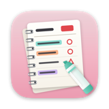
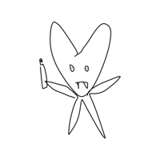
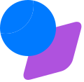

 

### 👋 About

macOS 네이티브 앱, 웹 서비스, 데스크톱 크로스플랫폼까지 **혼자서 끝까지 만드는** 메이커예요. 
요즘은 AI가 문서·이메일·업무를 대신 정리해 주는 **조용하고 집중되는 생산성 도구**를 만들고 있어요.

 

### 🚀 Products

<table>
  <tr>
    <td width="50%" valign="top">
      
      <b>Owlu</b> 
      AI가 이메일을 읽고 · 요약하고 · 워크플로로 처리하는 데스크톱 생산성 앱
        
       
      <code>Swift</code> <code>C# · Avalonia</code> <code>FastAPI</code> <code>Next.js</code>
    </td>
    <td width="50%" valign="top">
      
      <b>Spiralday</b> 
      창 하나가 곧 종이 한 장. 10분 단위로 하루를 적고 한 장씩 넘기는 macOS 플래너
        
       
      <code>Swift</code> <code>SwiftUI</code> <code>Metal</code>
    </td>
  </tr>
  <tr>
    <td width="50%" valign="top">
      
      <b>SwagSaac</b> 
      실시간 공동 편집이 되는 팀 워크스페이스. 웹 · 데스크톱 · iOS
        
       
      <code>Next.js</code> <code>Electron</code> <code>Capacitor</code> <code>Prisma</code>
    </td>
    <td width="50%" valign="top">
      <b>🕷️ QuietCrawl</b> 
      내 Chrome 안에서 도는 오픈소스 크롤러 + AI 에이전트용 로컬 MCP 서버
        
       
      <code>TypeScript</code> <code>Chrome Extension</code> <code>MCP</code>
    </td>
  </tr>
  <tr>
    <td width="50%" valign="top">
      <picture>
        <source media="(prefers-color-scheme: dark)" srcset="assets/lah-dark.svg"/>
        
      </picture>
      <b>Lean Agile Hungry</b> 
      위 제품들을 만드는 회사의 공식 웹사이트
        
       
      <code>Next.js</code>
    </td>
    <td width="50%" valign="top">
      <b>🧥 TryOnSpace</b> &nbsp;·&nbsp; <b>🗳️ Userversion</b> 
      TryOnSpace 앱, 그리고 유저 의견을 로드맵으로 바꾸는 웹 SaaS (기획 중)
        
      
    </td>
  </tr>
</table>

 

### 📂 Open Source

| | Repository | |
|---|---|---|
| 🔐 | [**crypton**](https://github.com/Grwaywee/crypton) | 토큰 로테이션 기반 디지털 문서 보안 · 특허 KR 2024-0302KR 구현 |
| 💍 | [**geulria**](https://github.com/Grwaywee/geulria) | 캔버스 위에 펼치고 링으로 엮는, AI와 함께 쓰는 구조적 문서 서비스 |
| 🍎 | [**saac**](https://github.com/Grwaywee/saac) | Swift로 만든 macOS 앱 |
| 🧱 | [**RNPrebuildforMac**](https://github.com/Grwaywee/RNPrebuildforMac) | Mac용 React Native 프리빌드 |

 

### 🛠 Tech Stack

   
   
  

 

### 📊 Activity

  
  

  

